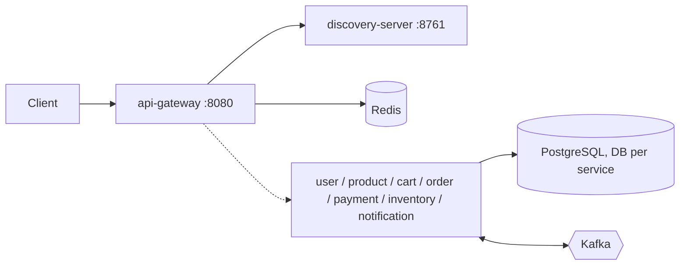
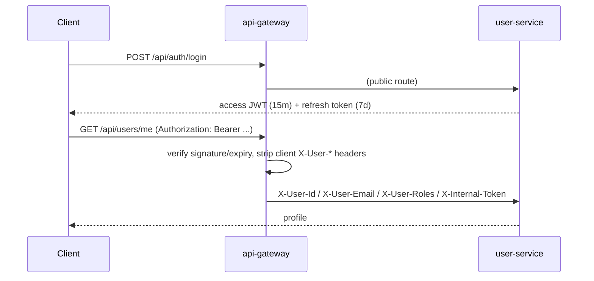
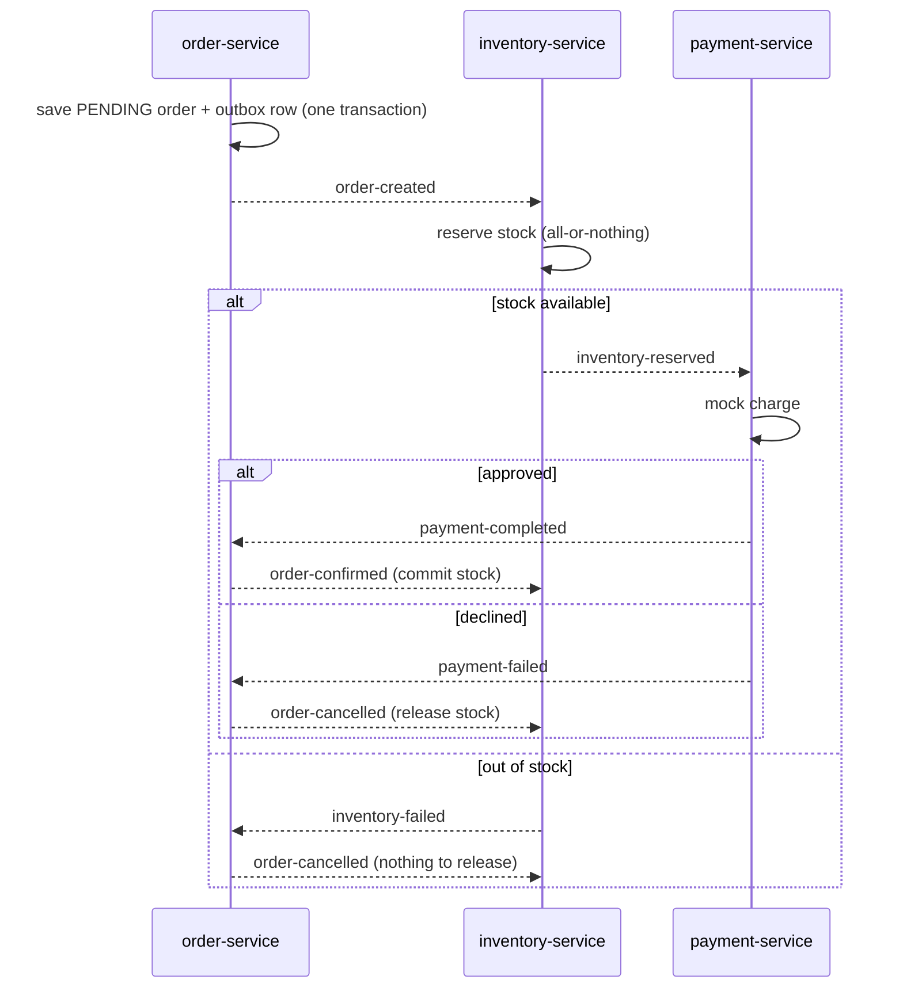

# MicroShop – Microservices E-Commerce Platform

Work in progress (Phase 6 of 8). The full README (API list, curl samples) arrives in Phase 8.



## Run (Phase 1)
```bash
docker compose up -d --build            # postgres, redis, kafka, eureka, gateway
docker compose --profile tools up -d    # + Kafka UI (8090) and MailHog (8025)
```

## Auth flow (Phase 2)

Default admin: `admin@microshop.local` / `Admin@12345` (override via `.env`).

## Catalogue & caching (Phase 3)
`GET /api/products?q=&categoryId=&minPrice=&maxPrice=&page=&size=&sort=price,asc` and `GET /api/products/{id}` are public;
creating, updating and deleting products and categories needs the ADMIN role.
Listings (2 min TTL) and product details (10 min TTL) are cached in Redis; every write evicts the affected entries.
Demo data lives in `product-service/src/main/resources/db/seed` (set `FLYWAY_LOCATIONS=classpath:db/migration` to skip it).

## Inventory & cart (Phase 4)
* **inventory-service** – `GET /api/inventory/availability?productIds=a,b` is public; stock management is ADMIN-only.
  `reserve` / `release` / `commit` (idempotent per order) are service methods that the Kafka saga calls in Phase 5.
* **cart-service** – `GET/POST/PUT/DELETE /api/cart...` for the logged-in user. Reads hit Redis, writes go to PostgreSQL
  first and then through to Redis. Product name/price are fetched from product-service when an item is added.

## Order saga (Phase 5)

Reliability: transactional outbox (no lost events), idempotent consumers (`processed_events`), retries with backoff,
then `<topic>.DLT`. Test cards: `tok_success`, `tok_decline`, `tok_insufficient_funds`, `tok_gateway_error`.

## Notifications (Phase 6)
notification-service listens to `order-confirmed`, `order-cancelled` and `notification-events`, stores an in-app
notification per event and queues an email. A background dispatcher sends queued emails (retrying up to 5 times), so a
dead mail server never blocks the saga. In dev all mail lands in **MailHog: http://localhost:8025**.

* `GET /api/notifications?unreadOnly=&page=&size=` - my notifications, newest first
* `GET /api/notifications/unread-count` - badge counter
* `PUT /api/notifications/{id}/read`, `PUT /api/notifications/read-all`
